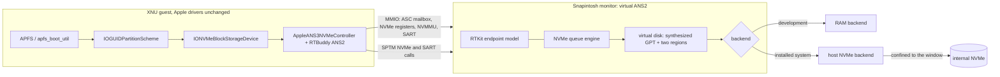

# Installing and booting macOS from the internal NVMe

This document describes how Snapintosh puts a macOS 27 (26A428) installation on
the ASUS Zenbook A16's internal NVMe SSD and boots it under the monitor: the
partition plan, the virtual Apple storage controller the guest talks to, the
host NVMe backend behind it, and the milestones from a read-only first boot to
a persistent writable system.

Boot-policy and signing questions are outside the scope of this document. Where
the installed boot needs Apple boot objects, it relies on Apple software the
user supplies.

> **Data-loss warning.** This route writes to the laptop's internal SSD. It adds
> a partition next to Windows (Windows' partition table changes: entries can be
> renumbered and the free space is consumed), and later writes a full APFS
> container into it. A mistake in any step can destroy Windows or its recovery
> partitions. Make a complete, restorable backup of the disk before starting,
> keep BitLocker recovery keys at hand, and expect to reinstall Windows if
> something goes wrong.

## Why an installed system

The first boot route ran Apple's BaseSystem (recoveryOS) from a RAM disk. It
reaches userspace, but WindowServer needs a Metal device, and a third-party
kext (our Adreno driver) loads only on a full installation, as on a real Mac.
The installed route gives the guest a real system volume, a writable Data
volume and our kext collection. See [GUI-BOOT-ROADMAP.md](GUI-BOOT-ROADMAP.md)
for how this fits the GUI work.

## Starting point

- Before this work the guest had no block device. Its root was a RAM image,
  and the firmware's NVMe driver disappears at ExitBootServices.
- Apple's own NVMe stack already starts in the guest. The J700 device tree keeps
  `/arm-io/ans` (role `ANS2`, linear submission queue, four namespaces) and
  `/arm-io/sart-ans`. Without a model behind them, the `RTBuddy(ANS2)` threads
  simply wait for a coprocessor that never answers.
- The monitor already implements the SPTM interface, including the NVMe table
  (admin queue, I/O queues, page map/unmap) and the SART table, so it sees every
  queue and DMA page the driver registers.
- The kernelcache has no VirtIO or paravirtual storage driver, and adding a
  third-party storage kext is not an option.

## Producing the installation (on a Mac)

The installation is produced on an Apple-silicon Mac with Apple's own restore
tooling (Virtualization.framework's macOS installer) into a raw, sparse 64 GiB
disk image. This step relies on Apple software the user supplies; nothing in it
is patched. The image is kept in two forms:

- **pristine**: the restored image, never booted, kept as the master to
  re-provision from;
- **configured**: an APFS clone of it, booted once in the Mac's VM to finish
  Setup Assistant (one local admin account, FileVault declined, automatic login
  on, clean shutdown). The guest had no keyboard at the time, so this is how
  the first account is created.

Checks before use: read-only attach, `diskutil apfs list`, `fsck_apfs -n` on
each container, and a manifest of container, volume and volume-group UUIDs and
the sealed snapshot name. An image whose Data volume is encrypted is refused:
the guest has no pre-boot unlock path and no Secure Enclave key services.

The 64 GiB container is deliberately smaller than the partition. An APFS
container may be smaller than its partition and can be grown later; it must
never be larger. Only allocated extents are transferred.

Producing the image inside the guest (running the installer from BaseSystem)
was rejected: the guest had no block device or network at the time, the
installer reboots into an update environment Snapintosh does not load, and an
hour-scale install under the monitor would not show whether a failure came
from the installer or the monitor.

## Partition plan

Exactly one new GPT entry is added in free space after the existing Windows and
Snapintosh data partitions, with a permanent 1 MiB unallocated guard on each
side. No existing partition is moved, resized, retyped or formatted.

| Field | Value |
| --- | --- |
| Type GUID | `af494c0f-7849-4186-8d2c-9b05cf6ab8b8`, a private Snapintosh type: Windows and the firmware do not interpret it, assign no drive letter and offer no format prompt |
| Placement | 1 MiB aligned at both ends, inside the largest free extent, with 1 MiB guards |
| Size on the development machine | about 393 GiB |
| Attributes | 0, or bit 63 ("no drive letter") if Windows sets it |
| Identity | the unique partition GUID Windows assigns, recorded immediately and pinned for every later step |

The entry is created by Windows' own partition manager, so Windows keeps both
GPT copies, their CRCs and its in-kernel view consistent. Neither q1n1 nor the
Mac gets a GPT write path. Windows may renumber entries when it re-sorts the
table by LBA; the slot is reported, never used as identity.

`tools/snapmac-partition-plan.py` is pure computation. Its `plan` mode turns a
GPT survey into the exact planned entry and refuses if the free extent or the
pinned neighbours differ from the record; `verify` checks after the change that
every existing entry kept its GUID, type, LBAs, attributes and name and that
exactly one new entry exists; `verify-undo` checks the reverse. Tests are in
`tools/test-snapmac-partition-plan.py`.

Four independent readers must agree after the change: Windows' own view, a raw
capture of the first and last 1 MiB of the disk decoded on the Mac, the
read-only GPT survey that q1n1 takes through the firmware before
ExitBootServices, and a normal Windows boot afterwards.

**Undo:** stop arming the window, remove the one partition by its recorded GUID
and type in Windows, and run `verify-undo`. Undo removes the entry, not the
bytes; the space returns to Windows.

## The window: what the guest sees

The partition is used as a *window*: one Windows-visible partition, laid out
internally for the guest.

| Partition-relative range | Guest view |
| --- | --- |
| 0 .. 1 MiB | Synthesized protective MBR and primary GPT, served from monitor memory. A 4 KiB window header (`SNAPWIN1`) sits on media at +512 KiB; the guest can never address it. |
| 1 MiB .. 513 MiB | Virtual partition 1: the iBootSystemContainer (ISC), seeded from a 256 MiB xART image |
| 513 MiB .. end - 1 MiB | Virtual partition 2: the main APFS container (System, Data, Preboot, Recovery, VM, Update) |
| last 1 MiB | Synthesized backup GPT |

The mapping is one linear rule (real LBA = window start + 8 x virtual LBA). The
guest sees 4 KiB blocks, which matches Apple's ANS format; the SSD's 512-byte
LBAs are never exposed, and every guest I/O is 4 KiB aligned on media, so no
read-modify-write occurs. Reads of the GPT areas return the synthesized bytes;
writes to them, and any I/O to the gaps or past the end, are refused. The
virtual GPT is built by the same code that builds the RAM disk's GPT
(`probes/bootmedia.py`); `probes/answindow.py` derives the window from the
header.

Apple's IOGUIDPartitionScheme, APFS and `apfs_boot_util` find the ISC and main
container they expect. The System volume stays sealed and is mounted read-only
from its snapshot, as Apple ships it.

The header holds the magic, a version, the partition's unique GUID and LBA
range, the block size, the region offsets and sizes, hashes of the provisioned
ISC image and container extent manifest, and a provisioning-state word. Only
provisioning writes it; the monitor and q1n1 read it when they arm the window.
`tools/snapmac-window-header.py` builds it and
`tools/snapmac-window-payload.py` packs the container's allocated extents.

## The virtual ANS2 controller (`compat/ans.c`)

The monitor answers Apple's own ANS2 NVMe stack (`AppleANS3NVMeController`,
IONVMeFamily and the RTBuddy `iop-ans-nub`) on the existing device-tree nodes.
Apple's drivers run unchanged.

| Alternative | Verdict |
| --- | --- |
| Virtual ANS2 behind Apple's in-box driver | **Chosen.** The driver is already probing, and the SPTM calls show the monitor every queue and every PRP page. |
| Virtual PCIe NVMe behind a virtual Apple PCIe root port | Rejected: modelling Apple's PCIe host bring-up is a far larger job for no gain. |
| RAM image | Kept for BaseSystem and as the development backend; not persistent. |
| VirtIO or a paravirtual kext | No in-box driver. |

What the model does:

1. **MMIO.** The `/arm-io/ans` and `sart-ans` register windows stay unmapped at
   stage 2 and are emulated: the ASC mailbox and RTKit v2 handshake (HELLO,
   endpoint map, management, crashlog, syslog and ioreport endpoints, buffer
   requests, power-state acknowledgements), the NVMe controller registers,
   Apple's linear-SQ doorbell and workaround registers, and the NVMMU window.
   The loader also supplies the firmware state the ANS2 nub expects from iBoot.
2. **SPTM NVMe and SART calls.** The monitor records admin and I/O queue
   addresses and the per-command page lists, and checks that every page is
   guest-owned and of a frame type allowed for DMA, under the same ownership
   rules as the DART audits.
3. **Command engine.** On a doorbell it reads the 64-byte entry from guest
   memory. Identify is synthesized (namespace 1 is the window, 4 KiB LBAs); log
   pages, features and I/O queue creation/deletion are answered locally; Apple
   vendor opcodes are answered or completed as Invalid Opcode. Read, Write and
   Flush go to the backend; Dataset Management is range-checked. Out-of-window
   I/O completes with "LBA Out of Range" and writes to synthesized GPT areas
   with "Access Denied". Completion writes the CQ entry, flips the phase bit
   and raises the controller's interrupt through the AIC model.
4. **Stop semantics.** Before any monitor stop report the model stops taking
   commands, drains in-flight ones and sends one Flush. It records commands,
   bytes, refusals by reason, dirty-since-flush and the lowest and highest real
   LBA written; the stopped-state audit (`probes/ansstate.py`) cross-checks
   these against the backend's own counters.

Host tests: `tools/test-ans.c` (build line in its header, including window
mode) and `python3 tools/test-ans-image.py`; `tools/ans-verdict.py` summarises
a run.

## The host NVMe backend (`compat/nvme-host.c`)

After ExitBootServices nothing else drives the SSD. q1n1 takes the controller
over (it resets it, sets up its own admin queue and one I/O queue pair in
reserved memory, and polls completions) and hands it to the monitor, whose host
backend (`compat/nvme-host.c`, host test `tools/test-nvme-host.c`) serves the
virtual controller's requests. Windows resets the controller again on its next
boot.

The write path is confined by construction:

- The window is armed once per boot. Arming reads both GPT copies, checks both
  CRCs and finds exactly one entry with the pinned unique GUID, the private
  type and the recorded LBA range, then checks the window header. Only then are
  writes possible, and the window cannot change until reboot.
- Read, write, flush and discard take window-relative LBAs; the absolute LBA is
  computed inside with overflow-safe bounds. No interface accepts an absolute
  LBA for a write.
- Admin commands are an allow-list (Identify, I/O queue create/delete, Get Log
  Page, Get Features, Set Features for the queue count only). Format,
  Sanitize, namespace management, firmware download/commit, security send and
  self-test cannot be expressed.
- PCIe DMA goes through the SoC's SMMUv3; the backend adapts to its state for
  its own buffers only.

**Read-only, then write-back.** The first installed boots ran with the window
read-only: every guest write was refused and counted, which proved the mapping
and the root mount without risk to the container. Write-back came next: guest
writes and Flushes reach the SSD, and an independent read after the run checks
that the APFS checkpoints of the main container and the ISC advanced with valid
checksums while the GPT, guards and header stayed unchanged. Writes are enabled
per run with an explicit option; the default is read-only.
`tools/build-nvme-writeback-probe.py` and `tools/qualify-nvme-writeback.py`
build and qualify the write path; `tools/capture-apfs-persistence.py` performs
the after-run check. Request sizes up to 512 KiB reads have been verified on the
hardware.

## Provisioning

Provisioning writes the window header, the ISC image and the container's
allocated extents (8 MiB chunks, about 28 GiB for the configured image), reads
everything back and compares hashes. It is resumable. The first provisioning
used Windows' own NVMe driver for the bulk writes; it was later replaced by
native q1n1 writes through the same armed-window service, with the same
identity, range and read-back checks. Updates to an installed system (for
example a new Metal plug-in) are packaged as a delta, replayed forward and back
on the Mac, then checked, probed and applied on the A16 with the same package
hash.

## Booting the installed system

Installed-boot guest profiles drop the RAM disk and publish the chosen
properties XNU and APFS read for an installed root: `boot-uuid` (the volume
group UUID; naming the System volume instead mounts the root but sends dyld to
a nonexistent Preboot directory), `apfs-preboot-uuid` and
`root-snapshot-name` (without it APFS panics with "Failed to find the root
snapshot"). The recovery-only device-tree actions for RAM-disk environments are
not applied to the installed system. The kernelcache, CPU assignments and guest
size are the same as on the RAM-disk route. Boots of the installed system are
driven by `tools/cycle.py` (see [RUNNING.md](RUNNING.md)).

The test Data volume is unencrypted (FileVault was declined in Setup
Assistant). Encrypted Data volumes and Secure Enclave key services are not
supported.

## Milestones

| # | What | Status |
| --- | --- | --- |
| M0 | Read-only GPT survey from q1n1 through the firmware, equal to the Windows record | Done |
| M1 | Installation image produced and checked on the Mac; Setup Assistant finished in the Mac's VM | Done |
| M2 | Virtual ANS2 with the RAM backend and a small test disk: the ANS2 handshake completes, the NVMe controller, block storage and media register, the GPT is enumerated and APFS probes the container, zero refusals | Done |
| M3 | q1n1's own NVMe access, read-only: Identify, and both GPT copies through its own queues equal the survey | Done |
| M4 | The one new partition, created by Windows and verified by four readers | Done |
| M5 | Window provisioned: header, ISC and container written and read back with matching hashes | Done |
| M6 | First installed boot, read-only window: the root mounts from the sealed System snapshot on the SSD and launchd starts | Done |
| M7 | Read/write window: Data mounts and installed-boot startup runs; after-run checks show valid, advancing APFS checkpoints | Met in practice: the installed system boots to the desktop with writes enabled |
| M8 | Persistence across boots: a second boot sees the first boot's changes | Met in practice: files installed in one boot persist into later boots; a full `fsck_apfs -n` of a read-back has not been recorded |

Beyond M6, the boot depends on Apple boot objects in Preboot; that part relies
on Apple software the user supplies and is not described here.

## Hardware questions that had to be answered

These could not be settled from the Mac and were answered by reads on the A16
before the first write:

| Question | Why it mattered |
| --- | --- |
| Does the firmware's GPT equal the Windows record (block size, last LBA, entries, free extent)? | The plan tool refuses on any difference. |
| Where is the NVMe (PCIe segment, bus/device/function, ECAM base, SMMU stream)? | The host driver pins the controller and stream from it. |
| What state does the NVMe function have after ExitBootServices? | Decides the reset sequence and whether Memory Space/Bus Master must be re-enabled. |
| Is the PCIe SMMU translating, bypassing or aborting the stream? | Decides whether the driver must install an identity entry for its buffers. |
| Identify facts: LBA formats, volatile write cache, Dataset Management, whether deallocated blocks read as zeros, transfer size | Sets Flush semantics and the provisioning strategy. A 4 KiB LBA format is never switched to: that would be a Format. |
| Does Windows boot normally after q1n1 has reset the controller and run its own queues? | The coexistence contract for every later boot. |
| Which slot and attributes does Windows choose for a custom partition type? | `verify` tolerates only attributes 0 or bit 63 and treats the slot as a note. |

## Known limits

- One guest I/O queue pair; completions are polled on the host side.
- No encrypted Data volume, FileVault or Secure Enclave key services.
- The container is 64 GiB until grown from inside the guest.
- A run that dies on the host side while the guest still runs must be allowed
  to reach its watchdog before the SSD is touched again; an interrupted native
  write is never restarted blindly.

See [STATUS.md](STATUS.md) for the current state of the installed system and
[ARCHITECTURE.md](ARCHITECTURE.md) for how the monitor is organised.
