# From first instruction to a GPU-accelerated desktop

This document is the history of the macOS GUI bring-up on the A16, organised as
the gates the boot had to pass: from the first XNU instruction to a desktop
drawn by WindowServer through the project's own Adreno Metal driver, with
keyboard and touchpad input. Each gate lists what had to be solved. Dates are
history markers only. The current state is in [STATUS.md](STATUS.md).

The goal throughout: a visible macOS GUI that responds to physical input, using
the unchanged Apple-shipped J700/T8140 26A428 kernelcache, with WindowServer
rendering through Snapintosh's own Adreno kext and Metal plug-in on the A16's
Adreno X2-90. CPU, software, paravirtual and host rendering were ruled out as
routes once WindowServer was shown to require a Metal device.

## Gates at a glance

| # | Gate | Reached |
| --- | --- | --- |
| 1 | Stock kernel executes under the monitor | September 2026 |
| 2 | Six CPUs and the platform devices XNU needs | September 2026 |
| 3 | Kernel console on the panel | September 2026 |
| 4 | Root file system mounted | September 2026 |
| 5 | launchd and userspace | September 2026 |
| 6 | WindowServer launches | September 2026 |
| 7 | Installed macOS on the internal SSD | September 2026 |
| 8 | Our GPU driver loads and draws a first Metal image | September 2026 |
| 9 | WindowServer accepts the Metal device and composites a frame | October 2026 |
| 10 | Login window and keyboard | October 2026 |
| 11 | Desktop with GPU acceleration and touchpad | October 2026 |
| 12 | Correct rendering and smooth presentation | October 2026, in progress |

```mermaid
flowchart LR
  A[XNU entry] --> B[six CPUs] --> C[panel console] --> D[root mount]
  D --> E[launchd] --> F[WindowServer launch]
  F --> G[installed system]
  G --> H[Adreno kext + Metal image]
  H --> I[WindowServer frame] --> J[login window] --> K[desktop + input]
  K --> L[smooth presentation]
```

## 1. Stock kernel executes (September 2026)

q1n1 runs at EL2 after ExitBootServices and loads the monitor, which enters the
Apple-shipped kernelcache at EL1 with the handoff the Mac's SPTM would provide.
What had to be solved:

- The SPTM interface itself. XNU on this Mac runs its page tables through
  SPTM calls; the monitor implements them (RETYPE, MAP_PAGE, table
  install/unmap, region updates, SLIDE_REGION) against 16 KiB guest tables and
  4 KiB hardware shadow tables. See [BOOT-CHAIN.md](BOOT-CHAIN.md) and
  [COMPATIBILITY.md](COMPATIBILITY.md).
- Apple-specific system registers and instructions trap to EL2 and are
  emulated; [APPLE-ENCODINGS.md](APPLE-ENCODINGS.md) lists them.

## 2. Six CPUs and the platform (September 2026)

- Physical A16 cores execute Apple's own warm-entry stub and reach
  `arm_init_cpu`; all six guest CPUs complete machine initialization, and
  cross-core IPIs are acknowledged.
- Device models answer what XNU's platform drivers touch first: the AIC
  interrupt controller, the memory controller's capacity and counters, the
  watchdog and the clock tree. The host's 19.2 MHz counter is converted to the
  24 MHz guest time base.
- Devices the board does not have (Apple GPU, ANE, camera, Type-C port
  controllers, the Wi-Fi/Bluetooth PCIe branch) are withdrawn from the device
  tree instead of being faked. CPU performance tables needed corrected
  frequency records before the performance controller would start.

## 3. Kernel console on the panel (September 2026)

The kernel draws its own boot console on the A16 panel through the GOP
framebuffer q1n1 hands over. The fix was choosing the console mode: with the
output bit of `serial=` set, XNU moves console output to the UART after early
startup; clearing it (`--console panel`) leaves drawing to the kernel's video
console. Framebuffer hashing before entry and after the stop proves which
pixels the guest drew.

## 4. Root file system (September 2026)

The first root was Apple's BaseSystem from a RAM image, published through the
stock DiskImages path so APFS mounts it natively. What had to be solved:

- The APFS volume UUID inherited from the image was all zeros, so the root
  device was never selected.
- The AES engine is used during root startup; a bounded model of the engine,
  its DMA and its interrupt was required.
- A separate iBootSystemContainer image supplies the xART, Preboot and
  Hardware volumes that `apfs_boot_util` waits for.

## 5. launchd and userspace (September 2026)

Userspace needed most of the SPTM's user-side contract:

- User address spaces (roots, ASIDs, commpage), the shared region (nesting
  about 1,800 shared tables and unnesting them on copy-on-write), SPRR and TPRO
  permission views per CPU, and the exception paths into and out of EL0.
- Pointer authentication works for the guest through monitor support for the
  architectural operations that trap.
- Long runs exposed a pmap panic after about 21 minutes: XNU lost track of page
  tables in memory the monitor had moved. Publishing the moved pointers fixed
  it.

The BaseSystem route reached up to 70 processes and ran to a 1,200 s watchdog
with no monitor stop.

## 6. WindowServer launches (September 2026)

On BaseSystem, WindowServer starts, waits 30 s for a Metal device and aborts
("No suitable Metal devices present after 30 seconds"); SkyLight has no
software-compositor startup path. A boot-framebuffer kext and the display
service chain were brought up along the way, but they cannot substitute for a
Metal device. Two decisions followed:

- Build a real Metal driver for the Adreno GPU (kext plus Metal plug-in plus
  shader compiler).
- Move to an installed system, because BaseSystem never loads third-party
  kexts, as on a real Mac.

## 7. Installed macOS on the internal SSD (September 2026)

A full installation lives in a dedicated partition on the A16's NVMe, reached
through a virtual Apple ANS2 storage controller in the monitor and a confined
host NVMe backend. The milestones (partition, provisioning, read-only boot,
write-back, persistence) are in [FULL-INSTALL.md](FULL-INSTALL.md). Further
gates on the installed system:

- The installed Data volume (unencrypted test volume) mounts and installed-boot
  startup runs; guest writes reach the SSD and APFS checkpoints advance.
- Larger NVMe transfers (512 KiB reads) and the driver's periodic statistics
  query were handled through the driver's own unsupported-result paths.

## 8. GPU driver and first Metal image (September 2026)

The Adreno X2-90 is driven by the project's own stack (see
[ARCHITECTURE.md](ARCHITECTURE.md) and the
[air2ir3 compiler](../gpu/air2ir3/README.md)):

- **Bring-up on the host.** The GPU was powered, identified and made to retire
  a first fence and draw a triangle from q1n1 before any guest used it. The
  monitor then took ownership of the GPU's power, firmware and ring, and
  exposes a narrow submission interface to the guest.
- **The kext.** AdrenoX2 (an IOGPU accelerator) and AdrenoDisplay load from
  the auxiliary kext collection on the installed system, register with IOGPU,
  map memory through a DART model translated to the SMMU, and complete a
  physical GPU fence.
- **The Metal plug-in.** AdrenoMetal implements Apple's Metal driver interface
  in userspace; air2ir3 translates Apple's AIR shader bitcode to Mesa's ir3
  and emits Adreno programs.
- **First image.** A guest Metal client rendered a triangle on the A16 GPU;
  851 pixels matched an independent reference, and the same image reached the
  panel through AdrenoDisplay's swap path once the boot console released the
  display.

What had to be solved on the way included IOGPU's segment threshold, texture
usage flags on render targets, resource lists and their lifetime, CPU cache
maintenance for a non-coherent GPU, and swap completion semantics.

## 9. WindowServer accepts the Metal device and composites (September to October 2026)

WindowServer then found the device and failed in a long series of ways, each
one a missing feature or wrong assumption:

- Panel mode requests whose arguments arrived in a different order than
  assumed.
- A startup wait on the time-synchronisation service's clock publication.
- Uncaught exceptions from shader features the compiler did not support yet
  (for example `no_perspective` interpolation, buffer textures, constant
  samplers). Real Core Animation scenes captured on a Mac were replayed through
  the compiler until they rendered exactly on Adreno.
- The 10-bit framebuffer format Core Animation picked by default, and render
  target shapes, views and formats the plug-in rejected.
- Depth/stencil passes and passes with several colour attachments.

In October 2026 the panel showed the first WindowServer-composited frame (the
boot progress screen), and WindowServer stayed up for whole runs.

## 10. Login window and keyboard (October 2026)

- The full macOS login window rendered on the panel.
- The keyboard works through SnapI2CHID, the project's I2C HID driver for the
  A16's keyboard and touchpad controller; a login with the built-in keyboard
  followed.
- A GPU command buffer that never retired latched the submission path; the
  monitor now bounds each buffer's execution time.

## 11. Desktop with GPU acceleration and input (October 2026)

The first user session drew the Dock, but WindowServer committed only about
one frame every 10 s. Profiling put 91% of its time in the guest kernel's
thread park/wake paths: the blocker was monitor overhead, not a missing GPU
feature. What had to be solved:

- Monitor speed: fine-grained locking instead of one service lock, a hardware
  page-table walk for 4 KiB user pages, atomic page-table descriptor writes
  (a torn descriptor caused transient stage-2 faults), cheaper root switches,
  and a small set of opt-in kernel patches for the hottest traps (see
  [KERNEL-PATCHES.md](KERNEL-PATCHES.md)). Guest CPU share rose from about a
  third to over three quarters.
- Input: the touchpad works as a pointer, then in Precision Touchpad mode with
  two-finger scrolling and gestures.
- Rendering: the wallpaper and widgets (half-float surfaces), real Dock icons,
  rounded corners, blur and the glass material (mip levels, 16-bit derivatives,
  framebuffer fetch).
- A thermal guard in the monitor stops a run if the SoC gets too hot.

## 12. Correct rendering and smooth presentation (October 2026, in progress)

- The present path's copy to the panel fell from about 67 ms to under 3 ms per
  frame, and a phase-locked 60 Hz tick replaced a drifting timer.
- WindowServer died about 30 s after its first present: Core Animation's APL
  filter kernel reached the compiler as AIR 2.2 with texture reads it did not
  handle. The compiler fix removed those aborts.
- Accelerate's matrix-coprocessor code paths crashed processes; the guest now
  reports that coprocessor as absent, so Accelerate uses its NEON paths.
- Half-drawn frames: the plug-in's `commitAndWaitUntilSubmitted` returned before
  the kernel had accepted the submission. Waiting for the submission fixed the
  glitches.
- Open: frame pacing under load, GPU address-space pressure, tearing, and the
  panel's 120 Hz mode after a steady 60 Hz.

## What counts as passing a gate

A static path, an offline test, driver registration, the text console or an
offscreen draw on a reference machine does not pass a presentation gate. Input
gates need real interaction on the A16, not just a running process. Each
hardware run is sized to answer one question, its complete stopped state is
captured and audited before the next run, and source support, offline replay
and on-device qualification are reported separately.

## Current state

See [STATUS.md](STATUS.md) for what works today and what is being worked on.
